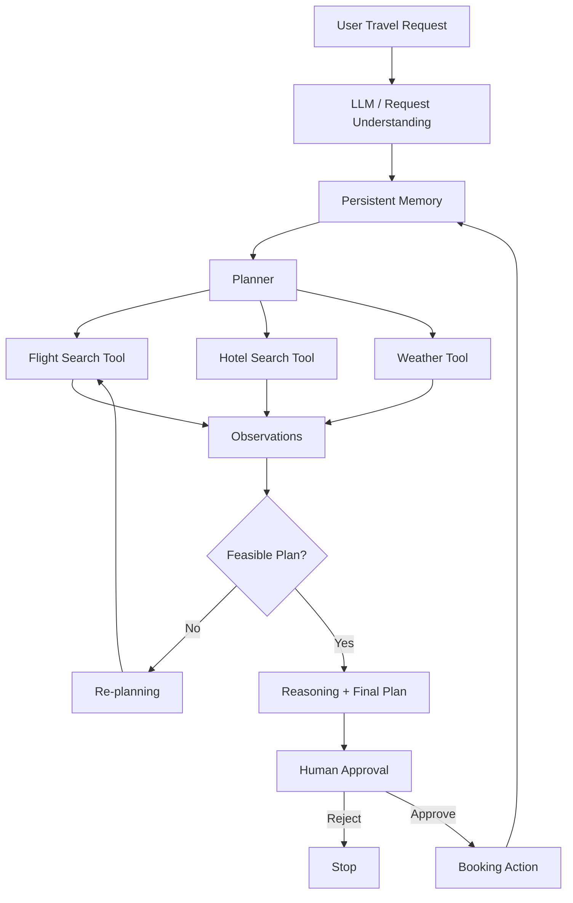

# Agent Architecture

## High-level architecture



## Agent loop

```text
Observe → Plan → Act → Observe → Reason → Re-plan if required
```

The booking action is deliberately placed behind a human approval gate.
